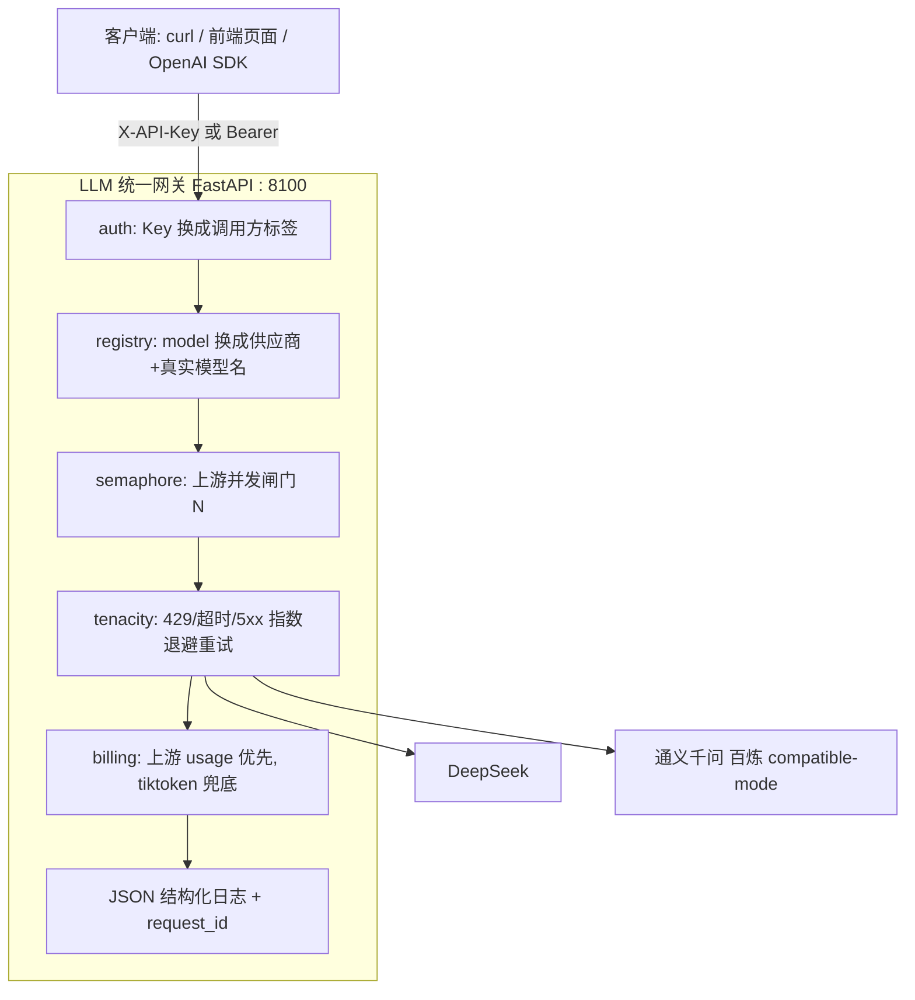

# LLM Gateway

[](https://github.com/Edison-star-lwb/llm-gateway/actions/workflows/ci.yml)

把 DeepSeek 和通义千问统一成一个 OpenAI 兼容接口：调用方只换 `model` 字段就能换供应商，
网关这侧自带 Key 鉴权、上游并发闸门、SSE 流式转发、按调用方记 token 账，
外加 `/health` `/metrics` `/usage` 三个观测端点。

## 特性

每条后面括号里是**当场验证它的方法**，不是形容词：

- **4 个模型路由**：`deepseek-chat` / `deepseek-reasoner` / `qwen-plus` / `qwen-turbo`（`GET /v1/models`）
- **两种鉴权头**：`X-API-Key` 或 `Authorization: Bearer`，Key 会被换成调用方名字写进每一行日志（`gateway/auth.py`）
- **上游并发闸门**：`asyncio.Semaphore`，大小由 `GATEWAY_MAX_CONCURRENCY` 决定（`gateway/main.py` 的 `semaphore()`）
- **SSE 流式 + 自动重试**：429 / 超时 / 5xx 走 tenacity 指数退避（`gateway/streaming.py`）
- **token 账本与指标**：JSONL 逐条落盘（上游 usage 优先、tiktoken 兜底），`GET /usage` 按调用方聚合，`GET /metrics` 给 2xx/4xx/5xx/in_flight 计数
- **多阶段镜像**：builder 装依赖并预热 tiktoken 缓存，runtime 只拷 `.venv`，非 root 用户 + `HEALTHCHECK`（`Dockerfile`）
- **10 个 pytest 用例全走 mock**：不需要真 Key、不花钱，CI 每次 push 在干净 Ubuntu 上重跑（`.github/workflows/ci.yml`）

## 架构



## 快速启动

**先决条件**（只需要一次）：

```bash
# 装 uv（Windows PowerShell）
powershell -ExecutionPolicy ByPass -c "irm https://astral.sh/uv/install.ps1 | iex"

# 装 uv（macOS / Linux）
# curl -LsSf https://astral.sh/uv/install.sh | sh

# 拿代码
git clone https://github.com/Edison-star-lwb/llm-gateway.git
cd llm-gateway
```

`.env.example` 里已经把 `MOCK_LLM=1` 设成默认，所以**下面两条路都不需要真实 Key、不会产生任何账单**。

**A. 本机 uv（不装 Docker）**

```bash
cp .env.examplcp .env.example .env            # Linux / macOSe .env
Copy-Item .env.example .env     # Windows PowerShell
uv sync --frozen
uv run uvicorn gateway.main:app --port 8100
```

另开一个终端验证：

```bash
curl http://127.0.0.1:8100/health        # Linux / macOS
```

**B. Docker Compose**（要先启动 Docker Desktop）

```bash
Copy-Item .env.example .env
docker compose up -d --build
curl.exe http://127.0.0.1:8100/health    # Windows PowerShell
```

**跑不通先查这三条**：

- `uv: command not found` → 上面的安装没生效，重开一个终端
- `No pyproject.toml found` 或 `ModuleNotFoundError: No module named 'gateway'` → 你不在仓库根目录，`cd llm-gateway`；如果报错路径里出现 `Anaconda`，说明 `uv run` 退回用了全局环境
- `address already in use` / `container name "/gateway" is already in use` → 8100 或容器名被上一份占用，见「常见问题」第 4、5 条

## 配置

```bash
Copy-Item .env.example .env     # .env 已在 .gitignore 里，不会入库
```

| 变量 | 必填 | 例子（不含密钥） | 谁读它 |
|---|---|---|---|
| `DEEPSEEK_API_KEY` | 接真上游时必填 | `sk-请替换成你自己的` | `registry.py` |
| `DEEPSEEK_BASE_URL` | 否 | `https://api.deepseek.com` | `registry.py` |
| `QWEN_API_KEY` | 接真上游时必填 | `sk-请替换成你自己的` | `registry.py` |
| `QWEN_BASE_URL` | 否 | `https://dashscope.aliyuncs.com/compatible-mode/v1` | `registry.py` |
| `GATEWAY_ALLOWED_KEYS` | 是 | `gw-dev-001:alice,gw-dev-002:bob` | `auth.py` + `billing.py` |
| `GATEWAY_DEFAULT_MODEL` | 否 | `deepseek-chat` | `config.py` |
| `GATEWAY_MAX_CONCURRENCY` | 否 | `8` | `main.py`（Semaphore） |
| `GATEWAY_UPSTREAM_TIMEOUT` | 否 | `30` | `registry.py` |
| `MOCK_LLM` | 否 | `1` = 完全不碰上游，用内置假流回包；`0` 或不设 = 真打供应商，要真 Key、会计费 | `registry.py` / `mock.py` |
| `GATEWAY_LOG_FILE` | 否 | 容器内写 `/app/data/app.log`（只有 `/app/data` 可写） | `logging_setup.py` |

`GATEWAY_ALLOWED_KEYS` 的格式是 `Key:调用方名`，冒号右边那个名字会出现在日志、`/metrics` 的 `by_caller` 和 `/usage` 的账本里——这是"谁花了钱"的唯一依据。

## 怎么用

**① 非流式**

Linux / macOS：

```bash
curl -s -X POST http://127.0.0.1:8100/chat \
  -H "X-API-Key: gw-dev-001" -H "Content-Type: application/json" \
  -d '{"model":"deepseek-chat","message":"用一句话说你是谁"}'
```

Windows PowerShell：

```powershell
curl.exe -s -X POST http://127.0.0.1:8100/chat `
  -H "X-API-Key: gw-dev-001" -H "Content-Type: application/json" `
  -d "{`"model`":`"deepseek-chat`",`"message`":`"用一句话说你是谁`"}"
```

**② 流式（SSE）**

Linux / macOS：

```bash
curl -sN -X POST http://127.0.0.1:8100/chat/stream \
  -H "X-API-Key: gw-dev-001" -H "Content-Type: application/json" \
  -d '{"model":"deepseek-chat","message":"从1数到5"}'
```

Windows PowerShell：

```powershell
curl.exe -sN -X POST http://127.0.0.1:8100/chat/stream `
  -H "X-API-Key: gw-dev-001" -H "Content-Type: application/json" `
  -d "{`"model`":`"deepseek-chat`",`"message`":`"从1数到5`"}"
```

`-N` 不能省：它关掉输出缓冲，否则整段流在结束时一次性打印，你看不出它是流式的。
PowerShell 里必须写 `curl.exe`——`curl` 是 `Invoke-WebRequest` 的别名，不认 `-N`，还会弹出「安全警告 是否要继续?」的交互确认。
## 测试与压测

```bash
uv run pytest -v
```

10 个用例（9 个测试函数，其中字段校验那个用 parametrize 展开成 2 例）覆盖鉴权、模型路由、SSE 分帧、重试。**全部走 mock，不需要真实 Key，不会花钱**——CI 上跑的就是这条命令。

```bash
uv run python bench.py --base-url http://127.0.0.1:8100 --key gw-dev-001 ^
  --model deepseek-chat --concurrency 50 --total 200 --stream
```

`--base-url` `--key` `--concurrency` `--total` `--model` 五个参数都是必填，`--stream` 是开关：带上就打 `/chat/stream`，不带就打 `/v1/chat/completions`。

## 设计权衡与已知不足

### 闸门取值：不是越大越好（§9.4 扫参）

客户端固定并发 50、200 请求、mock 模式：

| `GATEWAY_MAX_CONCURRENCY` | 错误 | p50 | p95 | RPS |
|---|---|---|---|---|
| 1 | 0 | 9146ms | 12050ms | 15.48 |
| 8 | 0 | 10384ms | 15495ms | 12.37 |
| 50 | 0 | 3948ms | 4603ms | 39.69 |

三句话：闸门 1 是**用延迟换稳定**（p95 12 秒但零错误）；闸门 50 吞吐最高，但接真上游时会撞供应商限流；**正确取值 = 上游限额减去余量，不是越大越好**。

闸门 8 比闸门 1 还慢，不符合单调预期。我复现过，量级一致，归因到单次测量的抖动——**这组数据不足以支撑"8 是最优点"的结论**，只够支撑"1 和 50 的取舍方向"。

### 并发闸门代码的三段演进（A → B → C）

- **A**：只有客户端并发，网关不设限。真实表现是上游限流时全量 429，重试风暴放大问题。
- **B**：在端点里写 `async with semaphore():`，但**忘了定义 `semaphore` 本身**。合并后 `/chat` 直接 500 `NameError`——本地跑过一次才算发现，静态检查看不出来。
- **C**：模块级惰性工厂 `semaphore()`，首次调用时按 `load_settings().max_concurrency` 建，全局共享一个。对应 commit `fe6486c`（PR #4）。

教训：**"引用了一个不存在的东西"这类 bug，只有真打一次那个端点才会暴露**。这也是下面 `/chat` 那个已知 bug 一直没被发现的原因。

### 提交历史：为什么前 5 节是一个 commit

```
73d689c chore: baseline gateway (providers, auth, streaming, billing)   ← §2–§6 一把梭
9be5d63 test: cover auth, model routing, SSE stream and retry           ← 从这里开始改成分支 + PR
210f586 feat: containerize gateway with multi-stage build and non-root user
e109a62 feat: add bench.py and /metrics for observability
fe6486c fix: define module-level semaphore for /chat rate limiting
96e0016 docs: write README with design tradeoffs and bench data
5350438 chore: add MIT license, CI workflow and README badge
```

§2–§6 当时还没有 PR 流程意识，六个小节的代码压在一个 baseline commit 里，**这六节各自改了什么，从 git 历史已经问不出来了**。§7 起改成"一个特性一个分支一个 PR"，后面 6 个 PR 每个都能单独回滚。

这个取舍我认了：早期一把梭换来了能跑起来的骨架，代价是那部分代码的演进过程不可追溯。

### 已知不足

- **`/chat` 和 `/v1/chat/completions` 不读 `MOCK_LLM`**，只有 `/chat/stream` 走 mock。所以非流式端点的测试必须真打上游或改走 stream 路径。这是端点间行为不一致，正确做法是把 mock 判断下沉到 `registry.py`，我还没做。
- **真模型压测受网络影响**：开 VPN 后 3 并发 15 请求全成功，p50 510ms / p95 920ms；不开 VPN 时大量 502。mock 数字（p50 约 40ms）和真实数字差一个数量级，**别拿 mock 的 RPS 当容量结论**。
- **Windows + Docker 的网络开销**：同一台机器上宿主机直连和容器内自测的延迟差约 500ms/请求，跨平台复现数据时这是主要噪声源。

## 目录结构

```
step10-gateway/
├── gateway/
│   ├── main.py            # FastAPI 路由 + request_id 中间件 + semaphore()
│   ├── auth.py            # X-API-Key / Bearer → 调用方名
│   ├── registry.py        # model → 供应商 + 真实模型名
│   ├── streaming.py       # SSE + tenacity 指数退避
│   ├── billing.py         # JSONL 账本，上游 usage 优先 / tiktoken 兜底
│   ├── metrics.py         # /metrics 进程内计数器
│   ├── mock.py            # MOCK_LLM=1 时的假上游
│   ├── config.py          # 环境变量读取
│   ├── schemas.py         # 请求/响应模型（注意 message vs messages）
│   └── logging_setup.py   # 结构化 JSON 日志
├── tests/                 # 10 个用例，conftest.py 用 autouse fixture 锁死 mock 环境
├── docs/architecture.md   # 上面那张 Mermaid 图的源文件
├── bench.py               # 压测工具
├── Dockerfile             # 多阶段 + 非 root + HEALTHCHECK
├── docker-compose.yml
├── .github/workflows/ci.yml
├── pyproject.toml / uv.lock / .python-version
└── .env.example           # 模板；.env 已 gitignore，密钥不入库
```

## 常见问题

**1. 在 PowerShell 里设了 `$env:MOCK_LLM=1`，压测还是 1500ms 一跳。**
容器读的是 `.env` 文件，不是你 PowerShell 会话的变量。必须写进 `.env` 再 `docker compose up -d --build`。验证：`docker compose exec gateway printenv MOCK_LLM` 要输出 `1`。

**2. 容器起不来，日志报 `PermissionError: /app/app.log`。**
镜像里只有 `/app/data` 属于 `app` 用户（`Dockerfile` 里 `chown`，之后 `USER app`）。`GATEWAY_LOG_FILE` 必须是 `/app/data/app.log`。

**3. 日志报 `FileNotFoundError: /app/<你的Windows路径>/app.log`（例如 `/app/E:/projects/app.log`）。**
同上一条，但根因是你把 Windows 绝对路径写进了 `.env`。容器里没有 `E:`，它被当成相对路径拼到 `/app` 后面。

**4. `curl` 打 `/chat` 返回 422。**
`/chat` 要 `{"message": "..."}`（单数字符串），`/v1/chat/completions` 要 `{"messages": [...]}`（复数数组）。两个 schema 都设了 `extra="forbid"`，多写字段也会 422。

**5. 明明改了代码，`/metrics` 还是 404。**
8100 端口被一个**旧进程**占了，请求根本没进容器。`netstat -ano | findstr :8100` 看 PID，`taskkill /PID <那个数> /F` 干掉再试。判断"是不是新代码"的指纹：`/metrics` 从 404 变成 200。

## 贡献流程

Conventional Commits + 一个特性一个分支一个 PR：`feat/` `fix/` `docs/` `test/` `chore/`。
参考已合并的 #1–#6。PR 必须等 `ci` 检查变绿再 Merge。